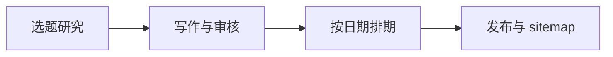

# content-orbit-skill

**I hate AI slop. But AI is useful.**

用于 SEO/GEO 内容研究、写作和定期发布的 Agent Skill。它根据指定项目的产品资料和目标市场筛选选题，生成文章与审核记录，再按发布日期生成网站所需的文章数据和 sitemap。

适用于维护产品博客、多语言内容站和编辑日历。各项目独立配置语言、模型、排期和发布方式，通过现有网站的构建流程上线。

## 工作流程



DataForSEO 提供关键词和搜索结果数据，Google Trends 支持 CSV 与 RSS 输入。JEV 判断选题与项目的相关性；文本模型负责写作和复核。Agent 阅读来源、准备写作简报，并检查文章中的关键事实。

审核通过的文章按项目时区发布。尚未到期的稿件留在内容目录，网站构建时只读取本次发布的文章快照，页面数据与 sitemap 保持一致。

## 安装

需要 Node.js 22+、npm，以及支持 Agent Skills 的工具。

在目标项目目录执行：

```sh
npx skills add https://github.com/bugkiwi/content-orbit-skill
```

安装器会提示选择 Agent 和安装范围。也可通过参数指定，例如：

```sh
npx skills add https://github.com/bugkiwi/content-orbit-skill --agent codex --agent claude-code
```

添加 `--global` 可安装到用户目录。安装路径和选项见 [Skills CLI 文档](https://github.com/vercel-labs/skills)。

执行脚本前，进入安装器显示的 Skill 目录安装依赖。默认项目级路径为：

```sh
(cd .agents/skills/content-orbit-skill && npm ci)
```

安装后可在 Agent 中调用：

```text
使用 $content-orbit-skill，为当前项目准备下个月的文章。
先检查产品资料和现有文章，再研究选题、安排日期并生成稿件。
```

## 项目配置

在目标网站根目录复制配置模板。全局安装时，将 `SKILL_DIR` 改为实际安装路径。

```sh
SKILL_DIR="$PWD/.agents/skills/content-orbit-skill"
cp "$SKILL_DIR/examples/project.json" content-orbit-skill.project.json
cp "$SKILL_DIR/examples/product-facts.md" product-facts.md
```

配置分为两部分：

| 文件 | 内容 |
| --- | --- |
| [`content-orbit-skill.project.json`](examples/project.json) | 网站地址、语言与市场、关键词、内链、排期、模型和发布设置 |
| [`product-facts.md`](examples/product-facts.md) | 当前产品能力、价格、政策及可用于文章的资料 |

修改模板中的示例内容后，运行 `doctor` 检查配置和凭据状态：

```sh
node "$SKILL_DIR/scripts/cli.mjs" doctor --project content-orbit-skill.project.json
```

`root` 相对于配置文件所在目录；内容、状态和输出路径相对于 `root`。配置字段与命令参数见 [CLI 使用说明](references/cli.md)。

### 环境变量

在目标项目的 `.env` 中配置以下变量。完整模板见 [`.env.example`](.env.example)。

```dotenv
OPENROUTER_API_KEY=
DATAFORSEO_LOGIN=
DATAFORSEO_PASSWORD=
CONTENT_ORBIT_DEPLOY_HOOK=
```

| 变量 | 用途 |
| --- | --- |
| `OPENROUTER_API_KEY` | JEV 相关性判断、文章生成和模型复核 |
| `DATAFORSEO_LOGIN`、`DATAFORSEO_PASSWORD` | 关键词扩展和指定市场的 Google 搜索结果研究 |
| `CONTENT_ORBIT_DEPLOY_HOOK` | 可选；用于 `release --deploy` 请求网站重新构建 |

默认读取所选项目根目录的 `.env`，也可用 `--env` 指定文件；CI 通过 Secrets 注入。已有环境变量优先。代理连接支持 `HTTP_PROXY`、`HTTPS_PROXY` 和 `NO_PROXY`。

在网站仓库中忽略 `.env`、`.content-orbit-skill/`、`.generated/` 和 `node_modules/`。文章、研究资料、简报和审核记录保存在 `content/editorial/`，随内容变更提交。

## 使用

完整操作包括选题挖掘、搜索研究、简报、写作和发布，见 [工作流说明](references/workflow.md)。以下为常用命令，在目标网站目录执行：

```sh
ORBIT="$SKILL_DIR/scripts/cli.mjs"

# 检查未来一个月的排期缺口
node "$ORBIT" slots --project content-orbit-skill.project.json

# 从意大利 Google Trends RSS 筛选相关选题
node "$ORBIT" trends --project content-orbit-skill.project.json --locale it \
  --input 'https://trends.google.com/trending/rss?geo=IT' --threshold .75 --top 10

# 根据已完成研究的简报生成文章
node "$ORBIT" batch --project content-orbit-skill.project.json --limit 3

# 校验文章、来源和审核记录
node "$ORBIT" qa --project content-orbit-skill.project.json

# 为到期文章生成快照和 sitemap
node "$ORBIT" release --project content-orbit-skill.project.json
```

默认排期为一个日历月；已存在的文章会占用对应语言和日期，包括草稿。生成器跳过这些位置，保留已有内容。每篇文章默认至少研究五个不同的搜索结果，并经过单独的模型复核。

默认发布标准为质量分数至少 90、风险分数不高于 20，且没有事实等硬性问题。项目也可设置为逐篇批准。分数属于模型评审结果，事实核对和正文检查仍由内容维护者负责。

所有命令输出 JSON。DataForSEO 和 OpenRouter 调用需要相应账户余额；排期查询、校验和本地发布快照生成无需 API 凭据。调用次数、缓存和重试行为见 [CLI 使用说明](references/cli.md)。

## 定时运行

内容生产与网站发布分别调度。仓库提供两份 GitHub Actions 模板：

| 任务 | 模板 | 行为 |
| --- | --- | --- |
| 每周选题与写作 | [`editorial.yml`](examples/github/editorial.yml) | 挖掘关键词、补充排期，从已准备的简报中生成文章并创建 PR |
| 每小时发布检查 | [`release.yml`](examples/github/release.yml) | 检查已合并、已批准且到期的文章，按需请求网站重建 |

新选题的来源阅读和简报准备由 Agent 完成，可通过所用 Agent 工具的定时任务执行。`batch` 只处理已准备的简报。

使用 GitHub 模板时，在网站仓库安装本工具并提交 lockfile：

```sh
npm install --save-dev github:bugkiwi/content-orbit-skill#main
```

将模板复制到 `.github/workflows/`，配置 Secrets，并按项目调整安装命令、内容路径和状态缓存目录。生产环境建议将依赖固定到已审查的 commit SHA。模板的配置文件位于仓库根目录，`root` 为 `"."`。

发布任务需要保留部署状态记录，并与其他发布任务串行运行。GitHub 模板使用 Cache；需要更严格的并发和恢复控制时，应使用持久存储。部署失败与超时处理见 [发布说明](references/publication.md)。

## 网站接入

网站构建前执行 `release`，读取 `.generated/content-orbit-skill/current.json` 指向的发布目录：

| 文件 | 用途 |
| --- | --- |
| `articles.json` | 文章正文与公开元数据 |
| `sitemap.xml` | 配置的静态页面和本次发布的文章 URL |
| `release.json` | 发布标识、构建日期、时区和文章数量 |

文章路由、元数据、列表和相关文章应读取同一份快照，未来或未知文章返回 404。已有 sitemap 的网站应将文章数据合并到原有生成逻辑中，保留其他公共页面。

`release` 只生成本地文件。配置部署 Hook 后，使用 `release --deploy` 请求重建；构建完成后运行 `verify` 检查 sitemap 和文章路由。具体接入约定见 [网站发布说明](references/publication.md)。

## 开发

```sh
git clone https://github.com/bugkiwi/content-orbit-skill.git
cd content-orbit-skill
npm ci
npm run check
```

测试使用隔离项目和模拟 Provider 响应，覆盖排期、审核记录、未来内容隔离、sitemap、缓存和部署恢复。真实 Provider 连接及网站构建需在目标环境验证。

## 文档

- [Skill 入口](SKILL.md)
- [工作流与维护](references/workflow.md)
- [研究、证据与写作规范](references/research-writing.md)
- [CLI 命令与配置](references/cli.md)
- [网站接入与发布](references/publication.md)
